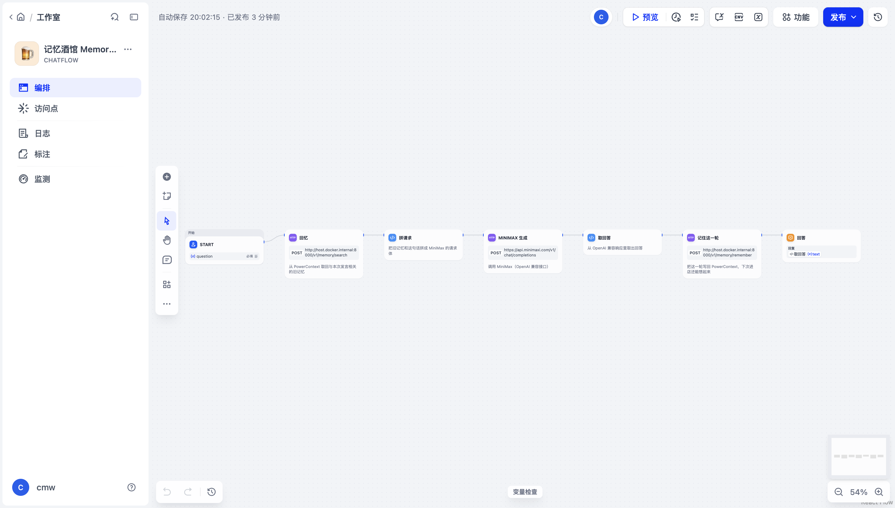

# 记忆酒馆 Memory Tavern

> 一间会记住你的酒馆：你上次点的酒、说过的心事，下次推门进来老板还接着聊。

Dify 编排 · PowerContext 记忆 · MiniMax 生成。属于「Just for Fun」赛题：不追求大而全，只做一个让人想再进一次门的小东西。

## 怎么玩

1. 打开应用（Dify 的 Web 界面或 API），见到酒馆老板。
2. 随便聊：说你是谁、点了什么、最近在忙什么。
3. 关掉页面，第二天再进来，问一句「老板，还记得我上次点什么吗？」——他会用上次的对话回你。

第一轮没有记忆，老板会问你的来历；每一轮结束后，这轮对话会写进 PowerContext；下一轮开始时先按当前这句话去记忆库里捞相关旧事，再交给模型。

## 技术分工

| 组成 | 在这里干什么 |
| --- | --- |
| **Dify** | 承担整条流程编排：`Start → 回忆(HTTP) → 拼请求(Code) → MiniMax 生成(HTTP) → 取回答(Code) → 记住(HTTP) → Answer`；模型调用、条件外的输入处理和输出都在 Dify 里完成 |
| **PowerContext** | 记忆层：`/v1/memory/search` 取相关旧事，`/v1/memory/remember` 写回本轮对话；scope 固定为一个，跨会话复用 |
| **MiniMax** | 生成层：`MiniMax-M3.1-Flash`，走 OpenAI 兼容的 `/v1/chat/completions` |

> 说明：模型这一步用的是 Dify 的 **HTTP Request 节点**直接打 MiniMax 的 OpenAI 兼容接口，而不是 Model Provider 插件。原因是本地自建实例的插件守护进程有一个租户 ID 的 bug（见文末），任何模型供应商注册表操作都会 500。DSL 里因此不含任何 provider 依赖，导入到任意 Dify 都能直接跑；要换成自带的模型供应商，把「MiniMax 生成」节点替换成 LLM 节点即可。

## 目录

```
dify/
├── dsl/tavern-memory.yml   # 应用 DSL（Chatflow），导入 Dify 即用
├── samples/conversation.md # 验证样例：真实跑出来的两轮对话
├── tools/smoke.py          # 等价冒烟脚本：用 DSL 里同样的三个请求验证记忆回路
└── README.md
```

## 运行

### 1. 起 PowerContext

```bash
uv tool install --force 'powercontext[cli,server]==1.2.0'
powercontext server run          # 默认 http://127.0.0.1:8000
curl -s http://127.0.0.1:8000/v1/scopes   # 拿 scope_id
```

DSL 里写死了 `scp_7f4cqa0evmrpw7hrqa0a9mh5t2` 和 `host.docker.internal:8000`（Docker 容器访问宿主机）。换 scope 或地址，改 `dsl/tavern-memory.yml` 里「回忆」「记住这一轮」两个节点即可。

### 2. 起 Dify

```bash
git clone https://github.com/langgenius/dify.git && cd dify/docker
cp .env.example .env
docker compose up -d          # 首次会拉镜像，约 6GB
# 打开 http://localhost ，完成管理员初始化
```

### 3. 导入应用

Dify 控制台 → 创建空白应用（Chatflow）→ 右上角「导入 DSL 文件」→ 选 `dsl/tavern-memory.yml`。

导入后把「MiniMax 生成」节点里的 `__MINIMAX_API_KEY__` 换成你自己的 Key，保存并发布。

### 4. 验证

在应用的对话界面按 `samples/conversation.md` 里的话术聊两轮，第二轮问「还记得我上次点什么吗」应该能看到上一轮的内容。

不起 Dify 也能验证记忆回路（用 DSL 里完全相同的三个请求）：

```bash
export MINIMAX_API_KEY=...
python3 tools/smoke.py "老板，还记得我上次点什么吗？"
```

真实输出（2026-10-31 实测）：

```text
[1] 回忆命中 0 条
[2] 客人：老板，还记得我上次点什么吗？
    老板：我这儿没留下你的酒单。新客，还是喝忘了？说说看，上次点的什么。
[3] 已写回 PowerContext
[4] 再查一次，命中 1 条（应大于等于上一次）
```

第 4 步从 0 变成 1，就是「写回后下次能查到」的直接证据。

## 本地实测（2026-10-31，Dify 1.17.1 自建）

DSL 已在本地 Dify 1.17.1 上**导入、发布并跑通**：



三轮真实调用（`POST /v1/chat-messages`，同一 conversation）：

```text
用户：我叫阿伟，今晚来一杯热的黄酒
老板：热黄酒，记下了。上次那杯没替你挡寒——这回也一个人？

用户：老板，我上次点的什么来着？
老板：热黄酒，阿伟。昨晚你一个人来的——这回也一个人？

用户：最近有点累，店里有什么推荐的？
老板：第一次见你。累的话，来杯热黄酒加蜂蜜，暖胃；酒不能替你扛事。你是身体累，还是心里累？
```

第二轮把第一轮的名字和酒都答出来了，说明 `回忆(HTTP) → MiniMax → 记住(HTTP)` 这条回路在 Dify 里是真的通的。

### 两个部署上必须注意的坑

1. **管理员必须走安装向导创建**（浏览器打开 `/install` 填表），不要用 API 直接 `POST /console/api/setup`。用 API 建出来的账号租户上下文没绑好，之后任何涉及模型供应商/插件注册表的接口都会 500（`invalid input syntax for type uuid: "current"`）。
2. **HTTP 节点访问本机服务会被 SSRF 防护拦**。把 `docker/.env` 里的 `SSRF_PROXY_HTTP_URL`、`SSRF_PROXY_HTTPS_URL` 置空（或把 PowerContext 放到公网），否则报 `Access to ... was blocked by SSRF protection`。

## 已知问题（本地自建 Dify 早期尝试）

在 Dify **1.18.0 和 1.17.1** 上都复现：一旦安装任意模型供应商插件，所有涉及供应商注册表的接口都会 500，日志为

```
PluginDaemonInternalServerError: ... ERROR: invalid input syntax for type uuid: "current" (SQLSTATE 22P02)
```

表现为：模型供应商页面打不开、DSL 导入失败、工作流草稿保存失败。试过换版本、补 `X-Workspace-Id`/`X-Tenant-Id` 头、从市场安装与上传 `.difypkg` 安装，都没绕过。

因此本作品把模型调用放在 HTTP Request 节点里，DSL 不带 provider 依赖——这也让它在评审自己的 Dify 上更容易一次导入成功。
